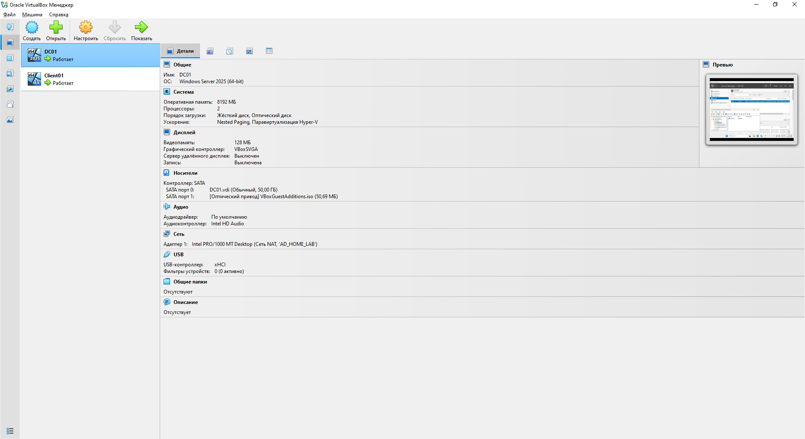
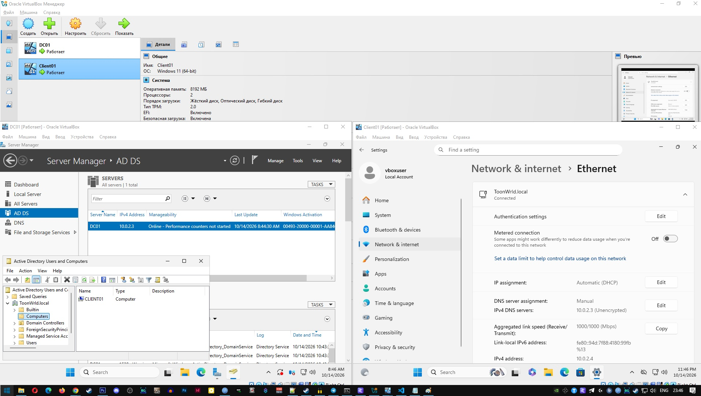
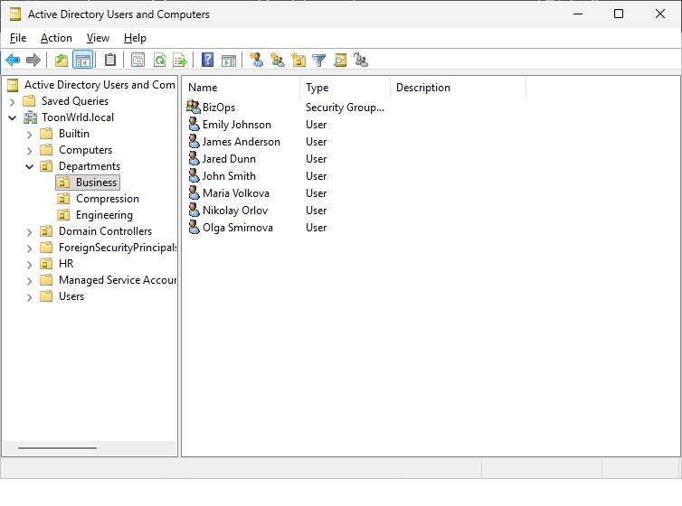
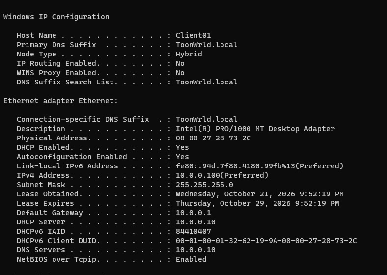

# Домашняя лаборатория: Развертывание инфраструктуры Active Directory

## 📋 Описание

**Цель:** Построение домашней лаборатории Active Directory для практического изучения администрирования Windows Server.

**Стек технологий:**
- **Серверная ОС:** Windows Server 2025
- **Клиентская ОС:** Windows 11 Enterprise
- **Службы:** Active Directory Domain Services (AD DS), DNS
- **Домен:** ToonWrld.local

## 🖥️ Хостовая система (Test Environment)

| Компонент       | Характеристики                          |
|-----------------|-----------------------------------------|
| **Процессор**   | AMD Ryzen 5 3600 (6 ядер, 12 потоков)   |
| **ОЗУ**         | 64 ГБ DDR4                              |
| **Диски**       | 1 ТБ HDD (Samsung HD103UJ) + 500 ГБ NVMe SSD (Samsung 970) |
| **ОС**          | Windows 10 Pro (64-bit)                 |
| **Гипервизор**  | Oracle VirtualBox 7.2.20                |

## 🌐 Текущая схема сети

| Узел             | IP-адрес                    | Примечание                                                        |
|------------------|-----------------------------|-------------------------------------------------------------------|
| Виртуальная сеть | `10.0.0.0/24`               | NAT Network `AD_HOME_LAB` в VirtualBox                            |
| Шлюз             | `10.0.0.1`                  | Шлюз VirtualBox NAT Network                                       |
| DHCP-сервер      | `10.0.0.10`                 | DHCP Server на DC01                                               |
| **DC01**         | `10.0.0.10` (статический)   | Контроллер домена, DNS-сервер.                                    |
| **Client01**     | по DHCP (`10.0.0.100`)      | DNS автоматически (`10.0.0.10`)                                   |
| Домен            | `ToonWrld.local`            |                                                                   |

## 🚀 Проделанные шаги

### Подготовка
- [x] Скачивание **VirtualBox** (VirtualBox-7.2.20-175154-Win.exe)
- [x] Скачивание расширения **VirtualBox Extension Pack** (Oracle_VirtualBox_Extension_Pack-7.2.20.vbox-extpack)
- [x] Скачивание образа установки **Windows 11 Enterprise** (26200.6584.250915-1905.25h2_ge_release_svc_refresh_CLIENTENTERPRISEEVAL_OEMRET_x64FRE_en-us.iso)
- [x] Скачивание образа установки **Windows Server 2025** (26100.32230.260111-0550.lt_release_svc_refresh_SERVER_EVAL_x64FRE_en-us.iso)
- [x] Установка **VirtualBox**
- [x] Создана **NAT-сеть** с названием `AD_HOME_LAB` (10.0.2.0/24, DHCP enabled)

### Создание виртуальной машины DC01 (контроллер домена)
- [x] Создана ВМ: RAM — 8 ГБ, CPU — 2, вирт. диск 50 ГБ, сеть NAT: `AD_HOME_LAB`
- [x] Установлена и настроена **Windows Server 2025**
- [x] Установлена поддержка **Guest Additions**
- [x] В **Server Manager** установлена роль **Active Directory Domain Services**
- [x] Система повышена до **контроллера домена**
- [x] Назначено доменное имя **ToonWrld.local**

### Создание виртуального клиента Client01
- [x] Создана ВМ: RAM — 8 ГБ, CPU — 2, вирт. диск 50 ГБ, сеть NAT: `AD_HOME_LAB`
- [x] Установлена и настроена **Windows 11 Enterprise**
- [x] Установлена поддержка **Guest Additions**
- [x] Система присоединена к домену **ToonWrld.local**

### Ручное администрирование AD (базовые операции)
- [x] Создана корневая OU **Departments** и три подразделения: **Engineering**, **Compression**, **Business**.
- [x] Созданы группы безопасности: **Engineers**, **CompressionTeam**, **BizOps**.
- [x] Созданы учётные записи первых пользователей вручную (через ADUC).
- [x] Пользователи добавлены в соответствующие группы безопасности.
- [x] Компьютер **CLIENT01** перемещён в OU **Engineering**.
- [x] Отработан сброс пароля пользователя (с учётом правила «сначала вход, потом смена»).
- [x] Создана и прилинкована GPO с баннером безопасности, проверена на клиенте.

### Автоматизация AD (PowerShell + CSV)
- [x] Написан/использован скрипт `AD-Admin-Console.ps1` для меню-ориентированного администрирования.
- [x] Массовое создание пользователей через CSV-импорт (`New-Users-FromCsv`).
- [x] Автоматическое добавление пользователей в группы.
- [x] Диагностирован и исправлен баг с перезаписью `$_` во вложенном `ForEach-Object`.

Исправленный скрипт меню-ориентированного администрирования: [AD-Admin-Console-fixed.ps](Scripts/AD-Admin-Console-fixed.ps)

### Развертывание DHCP Server
- [x] Отключен встроенный DHCP в VirtualBox NAT Network (`AD_HOME_LAB`).
- [x] Префикс сети AD_HOME_LAB в VirtualBox изменен на 10.0.0.0/24.
- [x] Зафиксирован статический IP-адрес на контроллере домена (DC01: `10.0.0.1`).
- [x] Установлена роль **DHCP Server** на DC01.
- [x] Выполнена авторизация DHCP-сервера в Active Directory.
- [x] Создана и активирована область (Scope) `AD_Lab` (диапазон `10.0.0.100–10.0.0.200`).
- [x] Настроены параметры области: шлюз `10.0.0.1`, DNS `10.0.0.10`, DNS-суффикс `ToonWrld.local`.
- [x] Проверена выдача IP-адреса на клиенте CLIENT01 (`ipconfig /all`).

## 🛠️ Список решенных проблем (Troubleshooting Log)

### 1. Аппаратная виртуализация (BIOS/UEFI)

**Проблема**: Ошибка AMD-V is disabled при запуске виртуальной машины.

**Решение**: Зашел в BIOS материнской платы (Gigabyte B450), нашел и активировал режим SVM Mode (аппаратная виртуализация AMD).

### 2. Восстановление загрузчика ОС (Операционная система)

**Проблема**: После прерывания установки Windows Server не загружалась из-за отсутствия загрузочных записей.

**Решение**: Загрузился в среду восстановления (WinRE). Через diskpart назначил букву скрытому системному разделу (100 МБ). С помощью утилиты bcdboot вручную восстановил загрузчик (bcdboot D:\Windows /s Z: /f UEFI).

### 3. Службы разрешения имен (Уровень сети/DNS)

**Проблема**: Ошибка An Active Directory Domain Controller (AD DC) for the domain could not be contacted при попытке ввести клиент в домен.

**Решение**: Выявил, что клиент использовал публичные DNS (1.1.1.1). Вручную изменил настройки TCP/IPv4 на клиенте, указав в качестве предпочитаемого DNS-сервера IP-адрес контроллера домена (10.0.2.3).

### 4. Автоматизация AD: пользователи создавались, но не добавлялись в группы (PowerShell)
**Проблема:** При массовом импорте пользователей из CSV (`New-Users-FromCsv`) учётные записи создавались корректно, но добавление в группы безопасности не выполнялось. Скрипт выдавал предупреждение:
`WARNING: Group add failed: Cannot validate argument on parameter 'Members'. The argument is null or empty.`

**Причина:** Вложенный `ForEach-Object`, который разбивал строку групп на отдельные имена, перезаписывал автоматическую переменную `$_`. В результате внутри вложенного цикла `$_` содержал уже **имя группы**, а не объект пользователя. Выражение `$_.SamAccountName` возвращало `$null`, и командлет `Add-ADGroupMember` получал пустой аргумент `-Members`.

**Решение:** Перед вложенным циклом сохранил `SamAccountName` пользователя в отдельную переменную `$sam`, а имя группы — в `$groupName`. Это исключило конфликт имён и позволило корректно добавлять пользователей в группы.

### 5. Потеря сетевой связности DC01 после отключения DHCP в VirtualBox (APIPA)
**Проблема:** После отключения встроенного DHCP в VirtualBox контроллер домена (DC01) потерял IP-адрес и получил адрес автонастройки `169.254.x.x` (APIPA). Установка роли DHCP Server приостановилась.

**Причина:** Ошибка конфигурации. Перед отключением DHCP-сервера в VirtualBox я не убедился, что на сетевом адаптере DC01 жестко задан статический IP-адрес. 

**Решение:** Вручную назначил статический IP-адрес (`10.0.0.10`), маску (`255.255.255.0`), шлюз (`10.0.0.1`) и DNS (`10.0.0.10`). Настроил область DHCP с именем `AD_Lab`. После этого авторизация DHCP в AD прошла успешно.

**Вывод:** Контроллер домена и серверы инфраструктуры всегда должны иметь статическую IP-адресацию. Перед изменением работы сетевых служб (DHCP) необходимо проверять базовую сетевую конфигурацию сервера.

### 6. Рассинхронизация времени на контроллере домена (Неверный часовой пояс)
**Проблема:** После установки Windows Server время на DC01 отличалось от реального на 15 часов. Это критично для Active Directory, так как протокол Kerberos отклоняет запросы при разнице во времени более 5 минут.

**Причина:** Ошибка конфигурации при первичной настройке ОС. Был выбран часовой пояс `UTC-08:00` (Тихоокеанское время) вместо правильного `UTC+08:00` (Иркутск).

**Решение:** В настройках Windows Server вручную изменен часовой пояс на `UTC+08:00`. Время автоматически синхронизировалось, и его совпадение с хост-системой было проверено визуально.

**Вывод:** Всегда проверять часовой пояс при развертывании серверов. Для корректной аутентификации в домене время на клиенте и сервере должно совпадать.

### 7. Блокировка входа в домен на клиенте из-за неверного DNS 
**Проблема:** После смены подсети и настройки нового DHCP, на клиенте CLIENT01 остался вручную прописан старый DNS-сервер (`10.0.2.3`). Из-за этого клиент не мог найти контроллер домена. При попытке выполнить действия, требующие прав администратора, появлялось окно UAC с ошибкой: *"We can't sign you in with this credential because your domain isn't available"*.

**Причина:** Замкнутый круг. Чтобы исправить настройки сети, нужны права администратора, а чтобы получить права доменного администратора, нужен работающий DNS.

**Решение:** 
1. В окне UAC нажал «More choices» и выбрал локальную учетную запись `.\vboxuser`, которая есть в кэше Windows после установки.
2. Под локальным админом открыл настройки сетевого адаптера.
3. Переключил получение IP и DNS на **«Автоматически»**.
4. Выполнил `ipconfig /renew`. Клиент успешно получил IP `10.0.0.100` и правильный DNS `10.0.0.10` от нового DHCP-сервера.

**Вывод:** В доменной среде настройки DNS на клиентах всегда должны быть автоматическими (через DHCP). Если домен недоступен, для исправления сетевых настроек необходимо использовать локальную учетную запись администратора.

## 📈 Планы по развитию лаборатории (TODO)

- [ ] Настроить File Server и Home Folders с маппингом сетевого диска через GPO.
- [ ] Расширить PowerShell-скрипт: логирование, создание домашних папок, проверки на существование объектов.
- [ ] Настроить резервное копирование через Windows Server Backup (с проверкой восстановления).
 
## 📸 Скриншоты

### 1. Виртуальная инфраструктура (VirtualBox)
Две виртуальные машины — **DC01** (Windows Server 2025) и **Client01** (Windows 11), объединённые в NAT-сеть. Параметры: 8 ГБ ОЗУ, 2 vCPU, 50 ГБ диск, включена аппаратная виртуализация (Nested Paging, Hyper-V Paravirtualization).

### 2. Контроллер домена и клиент в сети (Server Manager + Client01)
Слева — **Server Manager** на DC01: роль AD DS активна, IP-адрес `10.0.2.3`. (Скриншот до смены подсети на 10.0.0.0/24). Справа — сетевые настройки клиента: подключён к домену `ToonWrld.local`, DNS-сервер вручную указан `10.0.2.3`, IP получен по DHCP (`10.0.2.4`).

### 3. Структура Active Directory (ADUC)
Оснастка **Active Directory Users and Computers**: корневая OU `Departments` с вложенными подразделениями `Business`, `Compression`, `Engineering`. В `Business` создана группа безопасности `BizOps` и учётные записи пользователей.

### 4. Проверка работы DHCP на клиенте
Результат выполнения `ipconfig /all` на клиенте CLIENT01. Клиент автоматически получил IP-адрес `10.0.0.100` из области `AD_Lab`, шлюз `10.0.0.1` и правильные адреса DNS-серверов (`10.0.0.10`). Строка `DHCP Enabled: Yes` и указанный сервер `10.0.0.10` подтверждают успешную настройку и авторизацию новой роли.

